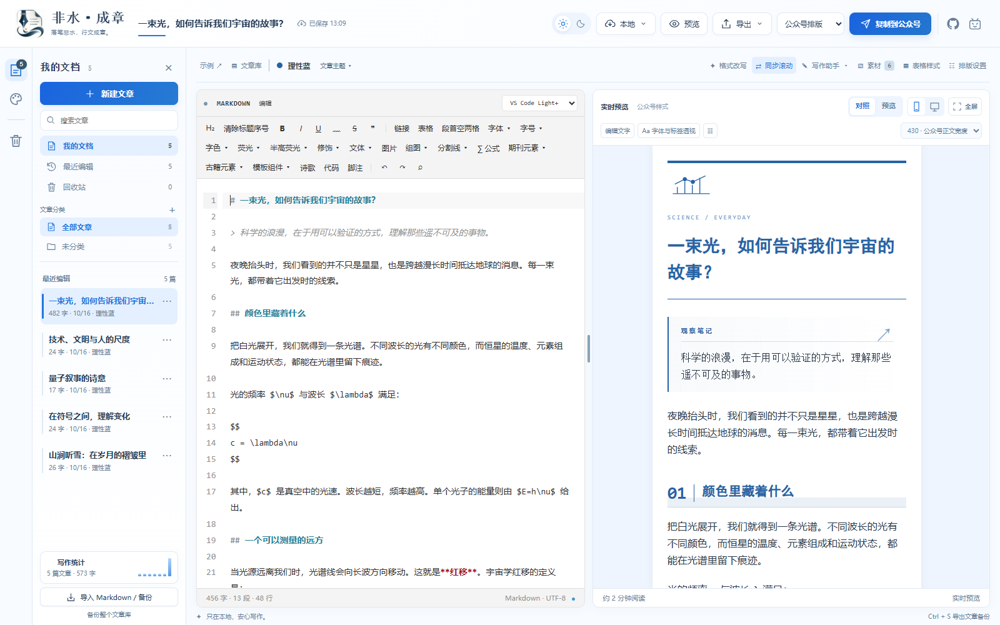
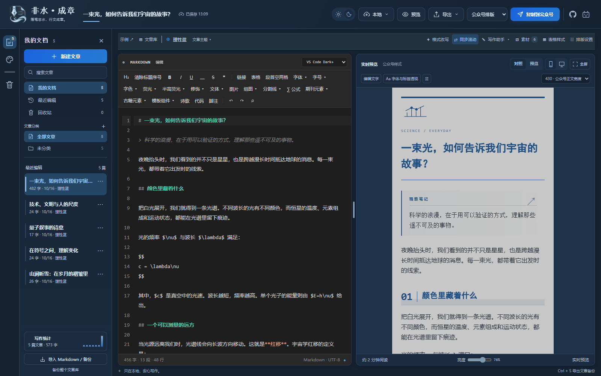
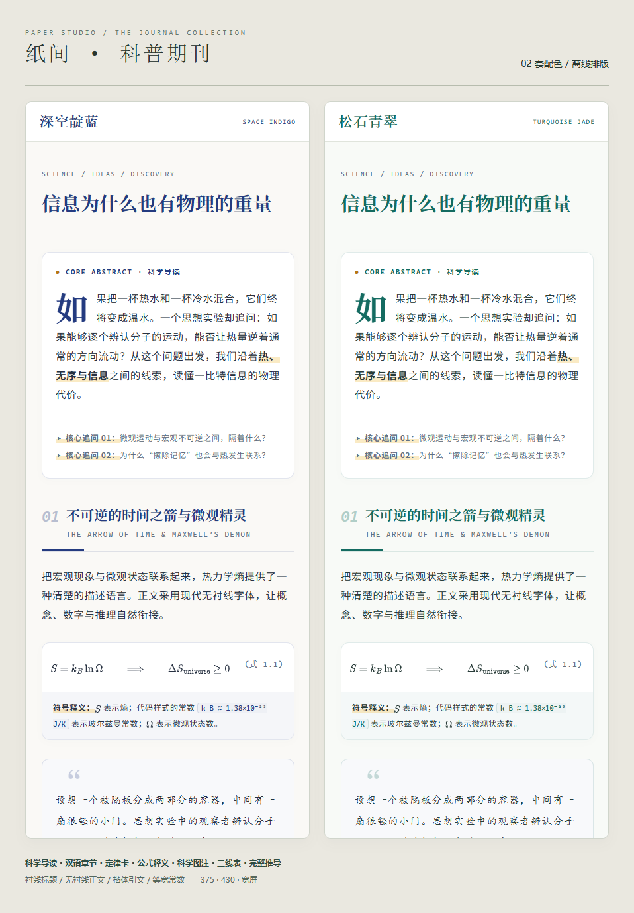
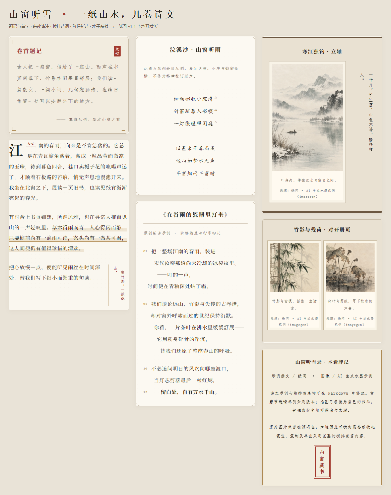
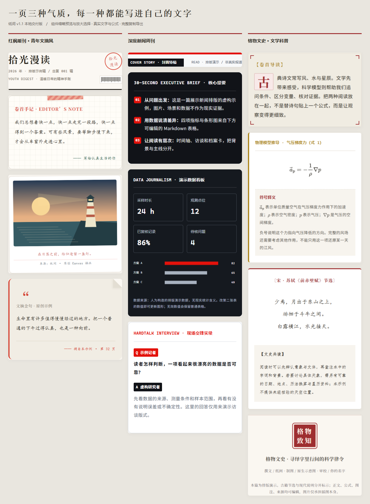
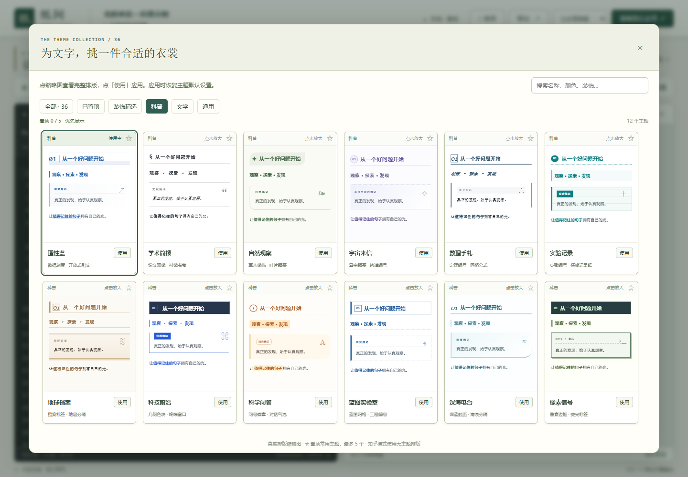
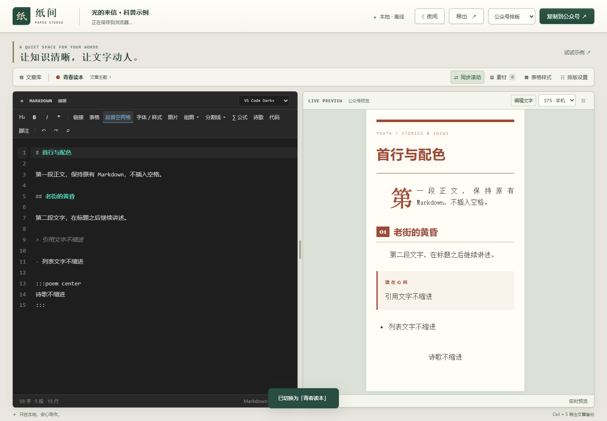

# 非水·成章

**落笔非水，行文成章。**

取「water不是水」中的「非水」，借「斐然成章」之意：文字经过精心编排，自成华章。仓库地址继续使用 waterzhijian。

**主分支 v1.1 开发版 · 稳定版离线下载 v1.0.1**

为科普、数学、散文与诗歌准备的 Markdown 排版工作台。左侧写作，右侧实时阅读；完成后复制到公众号或知乎，也可以保存为 HTML、Word、PDF 和长图。

**[立即在线使用](https://water0523.github.io/waterzhijian/)** · **[下载 v1.0.1 离线版](https://github.com/water0523/waterzhijian/releases/tag/v1.0.1)** · [详细使用说明](使用说明.md) · [版本记录](CHANGELOG.md)

不用注册账号。文章与图片保存在当前浏览器，工具不会自动上传正文或素材。下载单文件 HTML 后，双击即可完全离线使用，无需安装、启动服务器或加载 CDN。

### 本轮审查优化

新增命令面板、六标签写作面板、专注 / 打字机模式、斜杠插入、主题微调与对比、写作净增统计、章节拖拽、卡片工坊、智能粘贴和文章拆分 / 合并。修复撤销位置、预览选区、面板遮挡与来源检查；顶栏支持直接编辑文章名称。详见 [写作面板与效率工具](写作面板与效率工具说明.md)。自动保存仅保留最新自动版本，手动版本单独保留；历史窗口支持勾选删除与清除自动版本。

[交付说明](审查优化交付说明.md) · [详细补充审查与执行方案](补充审查与后续优化方案.md) · [本轮验收](本轮验收结果.md) · [当前构建数据](当前构建信息.md)

主题数量、文件大小、启动脚本与 SHA256 由构建自动生成，统一查看 [当前构建数据](当前构建信息.md)。

### v1.1 开发版

- 新增独立「试卷」分类与语文、数学、物理、地理、英语、生物六套湖南高考风格主题；每科都有无插图的题型示例、参考答案（宋体）和解析（楷体），英文默认 Times New Roman。含可预览试卷组件、答题留白、分页和格式改写提示词。[使用说明](试卷模板使用说明.md)。

- 排版设置可开启「公式自动编号」，独立公式按全文顺序显示 `(1)`、`(2)`…，保留手写 `\tag` 与跳过编号命令。设置随文章保存，复制与导出保留编号，Markdown 原文不变。

- 公式支持局部格式：在左侧选中 `\pi(x)` 或完整的 `\frac{x}{\ln x}`，直接用工具栏设置字色、字号、荧光、加粗、斜体、下划线和删除线。连续操作保留选区，复制与导出保留效果。

- 启动优先恢复上次文章及主题；公式、Word、代码高亮、备份压缩和示例图片按需启动，全部离线内嵌。主题缩略图按可见区域生成，主题轻试看和排版试改保留正文节点。

- 右上角的 GitHub / 哔哩哔哩图标可直接打开本项目和作者主页，支持日夜界面及键盘访问。

- 工作台按浅蓝界面重新整理：文档、最近编辑、分类、回收站与真实写作统计集中在左侧，顶栏显示文章标题与保存时间；日间默认浅色编辑区，夜间默认深色，保留自选配色。
- 文章名称默认跟随第一个顶层 H1；可直接点击左上角改名，清空或点恢复按钮回到 H1。名称独立保存，正文不改。
- 「写作助手」新增默认开启的本地公式命令补全：输入 `\fr`、`\b`、`\sq` 等前缀选择分式、希腊字母和常见数学命令；支持方向键、Enter / Tab 插入及片段逐项填写，开关会记住。

页首与浏览器标签页采用钢笔水纹标志，适配日间和夜间蓝色界面。

预览顶部新增「全屏」：对照和纯预览均可展开整个编辑器，点击「退出全屏」或按 Esc 返回。

「写作面板 → 发布」保留「格式改写」：选择特殊主题，复制只改格式、保留原文的 AI 提示词；可连同当前文章一次复制。支持原有六套专用主题、新增六科试卷主题和自定义继承，不调用 AI 或改动原稿。[查看完整提示词](主题格式改写提示词.md)。


- 工作台现采用淡蓝 / 天蓝，夜间采用深蓝灰；工具栏提供「清除标题序号」，整次操作可一次撤销。青年文摘、深度新闻周刊、格物文史与两套期刊的首字留白已重新调整。

本地开发版已加入主题导入与完整主题库管理：主题文件可定义正文、标题、引用、图注、诗歌的字体组合，以及标题、引用、公式、表格等元素样式。导入前有完整预览，移除后仍可恢复，文章与历史版本使用的自定义主题随 ZIP 备份保存。现有 50 套内置主题。这些功能已纳入主分支；GitHub Pages 页面随主分支的发布流程更新。已有稳定版 Release 下载仍为 v1.0.1，最新单文件位于 dist 目录。

- 新增深空靛蓝 / 松石青翠期刊主题：双语章节、首字导读、点阵定律、公式释义、可收起推导、三线表和要点 / 文献。配套 [期刊主题使用说明](期刊主题使用说明.md)、完整离线示例及 Aa 字体标签透视。
- 新增古籍文学「山窗听雪」：鱼尾章节、卷首题记、三种正文气质、朱砂夹批、横排词笺、阶梯新诗与三种水墨装裱。提供四幅离线水墨示例及[详细使用说明](山窗听雪使用说明.md)。已按要求移除《江雪》竖排效果，旧稿保留原文并横排显示。
- 新增「红枫暖刊 · 青年文摘风」「深度新闻周刊」「格物文史」三套完整模板。青年文摘与新闻周刊仅提供经典配色；文学科普使用朱砂、暗金与暖纸，正文、公式和符号释义均为真实可编辑内容。[新模板与组件使用说明](新增模板与组件使用说明.md)。
- 模板、古籍、期刊组件均提供实际缩略预览与放大查看，选择后再插入；预览跟随当前文章的设置，不改动原稿。主题搜索支持分类与多词组合、颜色、字体与标识；置顶、移除和恢复保留搜索及焦点。
- DeepSeek 选区改写支持少量上下文、结果比较与编辑、取消、失败保护和撤销。密钥默认仅当前会话使用，可主动记住或清除，不进入文章备份。已用模拟响应验证流程，未使用真实密钥或发起付费请求。
- [主题格式规范 v1](主题格式规范-v1.md) · [可直接导入的「杉影札记」示例](主题示例/杉影札记.纸间主题.json)
- 入口：文章主题 →「导入主题」或「完整主题库 / 管理」；排版设置中也有完整主题库入口。
- 主题管理支持搜索、分类、预览、单个导出、整库导出、移除、恢复与全部恢复。
- 自定义文件不加载脚本、HTML、外部样式或在线字体。文件上限 2 MB，自定义主题上限 100 个；字体使用本机回退链。
- 排版设置新增可折叠的「标题与元素细调」：分别调整 H1/H2/H3、引用、图注、表格、列表、代码、公式、诗歌和分割线；未修改的参数继续使用主题设计。支持单项恢复、单元素恢复与清除全部细调。
- 新增「写作助手」：公式命令补全、发布前格式检查、空白整理预览与撤销、手动恢复点、版本对比，以及科普 / 实验 / 随笔写作骨架。它不自动改写正文或核实知识事实。
- 新文章默认保留直接超链接；「链接」展开菜单或排版设置可改为文末参考。选择按文章保存并随 ZIP 迁移，知乎仍保留普通链接。
- 双窗口修改同稿时自动保留冲突副本，未完成的多篇草稿分别恢复。图注 / 尺寸 / 对齐跟随文章与新版恢复点，副本共用原图而独立排版。
- 底部选区菜单自动选择展开方向，应用 / 取消保持可见，选项内部滚动；窗口缩小或内容变化后重新定位。主题详情支持完整键盘浏览与 Esc 返回。
- 修复蓝图主题标题对比度、浅色代码高亮、图注和来源偏淡的问题；科普长标题换行与编号对齐。自选代码底色自动适配高亮，明确设置的文字颜色优先。
- 已按最新完成边界收尾：最后的文学科普主题已完成，只验收电脑兼容。平台内实际粘贴和 Word 分页的环境限制见[验收报告](验收报告.md)。













## 从一篇文章开始

1. 打开在线页面，或双击最新单文件 `dist/非水·成章-离线公众号排版器.html`。已有旧版离线入口继续保留。
2. 在左侧粘贴 Markdown。点击「试试示例」可体验科普、数学与诗歌。
3. 选择主题，调整字体、字号、行高、段距和阅读宽度。
4. 粘贴或拖入图片，插入公式、诗歌、脚注、表格与分割线。
5. 选择「公众号排版」或「知乎 · 无主题」复制，也可通过「文件 → 导出」保存。
6. 用 ZIP 备份长期保存文章，迁移到其他浏览器、设备或离线文件。

## v1.0.1 修订

修复中文标点后的加粗边界，例如 `**科普与知识分享：**清晰…`，引入一级标题自动命名。当前开发版默认跟随 H1，同时支持独立的手动名称。v1.0 原始标签与下载仍可访问。

## 写作与阅读工作台

| 功能 | v1.0 提供的体验 |
| --- | --- |
| 实时 Markdown | 约 200ms 更新预览，中文输入法组词期间保留输入状态 |
| 双向同步 | 源码行与预览段落对应定位，长图、公式和列表重新计算位置；可关闭 |
| 编辑器 | 行号、高亮、自动换行、撤销重做、查找替换与常用插入工具 |
| 预览改字 | 仅修改标题和正文文字，回写对应 Markdown；布局、图片、代码和表格结构锁定 |
| 选区快捷栏 | 加粗、斜体、下划线、波浪线、删除线、链接、标题/正文、引用、诗歌、代码和脚注 |
| 就地展开 | 字体、颜色、公式、表格和组图等菜单在按钮附近展开 |
| 写作统计 | 字数、段落数量、预计阅读时长与文章目录 |
| 分栏与手机 | 桌面中间边界可拖动；小屏幕切换「编辑 / 预览」标签页 |
| 阅读宽度 | 375px、430px 手机宽度和宽屏模式 |
| 习惯记忆 | 恢复主题、排版、预览宽度、桌面分栏与编辑器偏好 |
| 夜间模式 | 深色工作台；预览亮度可调 35%–100%，默认 78%，不影响导出 |

编辑器独立提供 **VS Code Dark+（夜间默认）、VS Code Light+（日间默认）、GitHub Light、Dracula、Monokai、Solarized Light** 六种配色。

## 44 套文章主题与 6 套试卷主题

标题、章节编号、引用、公式区域、图注和分隔呈现不同设计。科普主题内置数据图、书页、叶片、轨道、烧瓶、地层、芯片与蓝图等小装饰。

左侧主题库显示真实排版缩略图，鼠标悬停即用当前文章试看，移开恢复原主题与自定设置，点击才应用。支持分类、搜索和不限数量的收藏；在「收藏」中拖动排序，或点上移 / 下移。顺序会保存，并与原完整主题库共用。

| 分类 | 主题 |
| --- | --- |
| 科普 · 15 套 | 理性蓝、学术简报、自然观察、宇宙来信、数理手札、实验记录、地球档案、科技前沿、科学问答、蓝图实验室、深海电台、像素信号、深空靛蓝、松石青翠、格物文史 |
| 文学 · 14 套 | 青春读本、素笺、墨韵、月下诗页、旧日书信、山野随笔、抹茶手账、金色刊物、日落来信、薰衣草札记、赤陶画册、文言课本、山窗听雪、红枫暖刊 · 青年文摘风 |
| 通用 · 13 套 | 编辑部、周末长读、清爽薄荷、极简留白、橘子汽水、莓果气泡、复古报刊、奶油便签、卡通手账、像素电玩、库洛米灵感、波普漫画、深度新闻周刊 |

**青春读本**：杂志阅读风格，首段首字放大下沉，标题与装饰使用朱红强调色。普通插图居左或居右，正文环绕；滑块和数字调整图片宽度。杂志与角色灵感主题均为独立制作的风格设计，非刊物或角色方官方模板。



全篇可调整正文/标题字体、正文大小、行高、段距、边距和强调色。**「段首空两格」**独立开关随文章保存，按正文大小缩进，不修改 Markdown；诗歌、引用、列表与图注保持各自格式。

选中文字可分别展开字体、字号、字色、荧光、半高荧光、修饰和文体，支持悬停临时展开、移出收起及点击固定；选项点选即应用。字体和修饰直接显示格式；半高荧光使用紧凑色块。字色提供 16 色，整行 / 半高荧光各提供 17 色，并支持自定颜色。字体使用系统字体回退链，不嵌入商业字体文件；不同设备字形可能不同。

## 科学与数学排版

- `$…$` 行内公式与 `$$…$$` 独立公式，内置 MathJax SVG，不依赖在线数学字体。
- 分式、根号、积分、求和、矩阵、分段与多行推导。
- `aligned` 等号对齐；`align` / `equation` 连续自动编号，支持 `\notag` 和 `\tag{…}`。
- 常用公式菜单、彩色公式和 `\textcolor`。
- 数字、百分号、标点可叠加粗体等样式；普通公式整体或局部使用 `\boldsymbol`。复杂环境按表达式处理，避免破坏结构。
- 公式错误定位到源码，不阻断全文；公式可下载 SVG 或高清 PNG。
- 主题默认、三线表、斑马纹、网格四种表格样式，支持列表、引用、代码块和脚注。
- 科学插图可填写替代文字、图号、图注和来源。图号由作者指定。

## 图片、贴纸与文字环绕

在 Markdown 栏粘贴截图/图片文件、拖入文件或通过选择器添加。编辑区使用简短资源引用，原图存入本地文章库，不插入大段图片数据。

一次添加多张图片自动组成两列，可选 **逐张纵排、两列并排、三列网格、首图通栏**。菜单直接展开，点击图片组再次调整。原图不裁切，图注和来源保留，布局随 ZIP 备份恢复。

透明素材可转贴纸，提供左/右轮廓环绕与自由叠放。可调整大小、位置和旋转；自由叠放发布时可将相关区域转成图片。青春读本普通插图提供直接的左右环绕控制。

图片可单独下载，压缩由用户主动选择。网络图片可尝试导入本地副本；独立离线输出需要先补齐素材。

## 文学、诗歌与装饰

- `:::poem center` / `:::poem left` 保留逐行换行和诗节空行。
- 诗歌块支持加粗、波浪线、字体、颜色、行内公式、代码与脚注引用；脚注定义写在块外。
- 八种主题分割线：细线、双线、点线、菱形、草木、星轨、水波、像素。按主题推荐排序，颜色跟随强调色。Markdown `---` 仍可使用。
- 选区可转引用、H1/H2/H3、正文、诗歌和代码，保留选中文字。

## 公众号、知乎与文件导出

| 输出 | 内容与行为 |
| --- | --- |
| 公众号复制 | 主题样式转为内联 HTML，正文保持富文本，公式尝试以自包含 SVG 复制 |
| 文末参考链接 | HTTP(S) 外链默认去重集中到文末，正文保留文字与 `[参1]`；可关闭 |
| 知乎复制 | 标准 Markdown 富文本，保留标题、列表、引用、表格、图片、公式等，不附文章主题 |
| 独立 HTML | 内嵌本地图片与公式，脱离工具离线阅读 |
| Word `.docx` | 常规文档结构，正文可编辑；公式以高清图片保留，保留强调和诗歌样式 |
| PDF | 主题版或标准版打印页面，通过浏览器「另存为 PDF」保存 |
| 长图 PNG | 当前预览宽度，1/2/3 倍清晰度，包含主题、图片、公式与贴纸 |
| 长图复制/另存为 | 生成后预览，再复制 PNG 图片或另存为；取消保存保留结果 |
| 超长文章 | 分段覆盖全文，可逐张复制/保存或全部保存为 ZIP |
| Markdown/备份 | 普通 `.md` 导入导出；含图片时推荐 ZIP 保存资源与排版 |

复制按钮显示复制中、成功或手动复制状态。复制前检查公式与图片；受限时提供可选中的富文本区域，支持素材下载补插。

平台可能过滤 SVG、浮动环绕、多列表格或部分样式。请在粘贴并保存后检查；浏览器复制成功不代表平台最终兼容。需要保留完整外观时可使用长图。

## 本地文章库与恢复

- 停止输入约一秒后将正文、主题设置与图片保存到 IndexedDB。
- 文字恢复记录覆盖自动保存前的刷新、误关情况；存储失败保留内容并提示导出。
- 一级文件夹、搜索、新建、重命名、复制、回收站与恢复。
- 每篇最近 20 个恢复版本，共用图片资源减少重复占用。
- 单篇/整库 ZIP 包含 Markdown、图片、版本化配置与布局。导入先校验，再生成新文章 ID，避免覆盖同名草稿。

**在线页面、离线文件与不同浏览器的存储空间分别独立。** 更换入口或设备时，先导出 ZIP，再导入。在线页面首次载入需要网络，断网后可继续当前页面写作；需要随时离线打开，请下载单文件 HTML。

## 验证与 v1.0 边界

Windows Chrome / Edge 的全新离线上下文完成核心与专项验证，范围见 [验收报告](验收报告.md)。约 24616 字符、30 个公式、20 张图片的样例，普通编辑预览更新约 **260ms / 264ms**，结果依设备而变。

公众号/知乎登录后草稿保存重开、手机真机和 Word 人工分页仍待实测。原生另存为接口成功/取消分支采用模拟验证；PNG 系统剪贴板和浏览器下载实际执行。

**后续事项**：DeepSeek 选区改写、进一步主题细化与平台实测。分级标题/元素设计面板已在本地开发版补齐。v1.0 尚未接入 AI、云同步、账号、图床或自动发布。见 [待续功能](待续功能.md)。

## 开发与部署

开发环境：Node.js 20+、npm。使用 TypeScript、CodeMirror 6、markdown-it、MathJax SVG、DOMPurify、fflate、docx 和 html-to-image。

```sh
npm ci
npm run typecheck
npm run build
```

同时生成离线文件 `dist/非水·成章-离线公众号排版器.html` 和在线文件 `docs/index.html`。运行脚本、样式和公式资源内嵌；GitHub Pages 发布 `main` 的 `/docs` 文件夹。

本机 Chrome / Edge 可运行检查：

```sh
npm test
node tests/themes.mjs
node tests/preview-editing.mjs
node tests/interaction-upgrade.mjs
node tests/theme-gallery-images.mjs
node tests/publishing-extras.mjs
node tests/image-output.mjs
```

测试数据放在 `test-results/`，不提交。源码结构见 [开发说明](开发说明.md)，版本说明见 [RELEASE-v1.0.md](RELEASE-v1.0.md)。第三方软件保留各自许可证，构建附带 [软件许可声明](dist/THIRD_PARTY_NOTICES.txt)。

### 动漫手记主题

新增「樱粉魔法」与「抹茶猫猫」，位于通用分类；提供圆体胶囊章节、胶带引文、角色气泡、拍立得、公式手札与设定档案。15 种组件可预览后插入，格式改写提示词根据具体文本自主搭配并严格保留原文。完整说明见 [动漫手记主题使用说明](动漫手记主题使用说明.md)。

### 魔女之旅界面外观

右上角「界面」打开界面设置，可选择默认天蓝、「魔女之旅 · 轻装写作」或「魔女之旅 · 沉浸旅途」。三套外观统一面板与工具栏结构，天空融入顶栏；轻装版淡紫留白，沉浸版增加云海、城堡、伊蕾娜与参照角色形象制作的帽子。均支持日间 / 夜间并记住本机选择，默认版不加载插画。界面外观与文章主题分开，正文、编辑器配色和导出不受切换影响。完整说明见 [魔女之旅界面使用说明](魔女之旅界面使用说明.md)。

「修饰」新增细框标记、柔彩胶囊、书签侧线、朱砂括线与双线强调，可直接预览、切换或取消；支持预览选区、局部重选、跨正文段落及格式查找批量修改。见 [修饰样式使用说明](修饰样式使用说明.md)。
